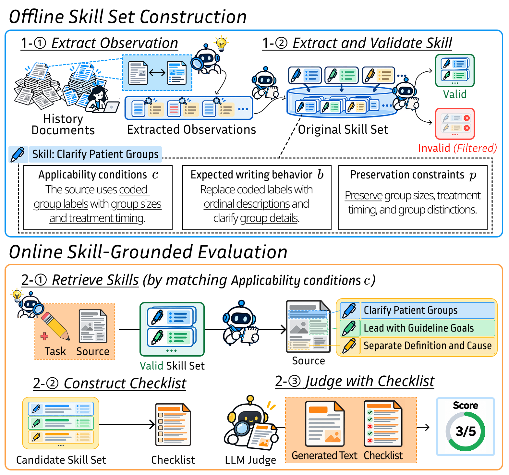

# When Fluency Beats Compliance: Judgment Reversal in Evaluating Domain-Specific Writing

This repository contains the code, prompts, and skill catalogs for the paper
**"When Fluency Beats Compliance: Judgment Reversal in Evaluating Domain-Specific Writing."**

We study whether LLM-generated text that reads fluently actually complies with the writing conventions
that experts follow in specialized domains. For nine tasks spanning three domains (**finance**,
**medical**, **law**) and three task types (**data-to-text**, **rewriting**, **summarization**), we:

1. **Extract** domain-specific writing *skills* from human-written references in the training split.
2. **Evaluate** human-written and LLM-generated outputs on the test split against the same
   skill-based checklist.
3. **Measure judgment reversal**: how often the LLM output satisfies more checklist items than the
   human reference (the **Judgment Reversal Rate, JRR**).

## Repository Structure

```text
.
├── LICENSE
├── config.yaml                 # Models, batch sizes, and per-dataset settings
├── requirements.txt
├── baseline/                   # Evaluation pipeline skeleton (see baseline/README.md)
├── common/                     # Shared code (all nine tasks use the same pipeline)
│   ├── run.py                  # Single command-line entry point
│   ├── config.py
│   ├── generation.py           # LLM output generation for the test split
│   ├── skill_schema.py
│   ├── verify.py               # Repository-level sanity checks
│   └── pipeline/
│       ├── data.py             # Loads TRAIN/TEST rows {id, source, human, llm}
│       ├── contracts.py        # Per-stage input/output contracts, JSON schemas, default DEDUPE prompt
│       ├── llm.py              # Strict-JSON API client (disk cache, validated retries)
│       ├── extract.py
│       ├── evaluate.py
│       ├── verify.py
│       └── scoring.py
├── prompts/<domain>/<task>.py  # Task-specific prompts: GENERATION, EXTRACT, MATCH, DEDUPE, JUDGE
├── skills/<domain>.json        # Domain skill catalogs (task-specific skills under topics.<task>.skills)
├── outputs/                    # Example evaluation output
└── data/<dataset>/             # train.json / test.json (one sample row each)
```

Datasets are named `<domain>_<task>`, e.g. `finance_dtt`, `medical_summary`, `law_rewriting`.

## Installation

Tested with Python 3.13.

```bash
pip install -r requirements.txt
```

Create a `.env` file in the repository root with the following API keys:

| Variable | Used for |
|---|---|
| `OPENAI_API_KEY` | OpenAI models |
| `OPENROUTER_API_KEY` | Models served through OpenRouter |

`openai` is only required for `generate --execute`; extraction and evaluation use the standard-library
HTTP client.

## Data

Every dataset uses the same format. `data/<dataset>/train.json` and `test.json` are lists of rows:

```json
[
  {
    "id": "155679",
    "source": "If your mobile device is turned on, our network is collecting data about where it is.",
    "human": "Our network is collecting geolocation data when your mobile device is turned on.",
    "llm": "When your mobile device is turned on, our network collects data about its location."
  }
]
```

| Field | Description |
|---|---|
| `id` | Unique row ID |
| `source` | Task input: a string for rewriting and summarization, a JSON object for data-to-text |
| `human` | Human-written output |
| `llm` | LLM-generated output (TEST only) |

### Sources

| Domain | Task | Dataset | Description | License |
|---|---|---|---|---|
| Finance | data-to-text | [DataTales](https://github.com/yajingyang/DataTales) | Write a daily market commentary from a one-week market price table | Not specified |
| Finance | rewriting | [FEINA](https://huggingface.co/datasets/saul1917/FEINA) | Simplify Spanish financial-education sentences | Creative Commons (version not specified) |
| Finance | summarization | [ECTSum](https://github.com/rajdeep345/ECTSum) | Summarize earnings-call transcripts into Reuters-style bullet points | GPL-3.0 (repository) |
| Law | data-to-text | [EPA ICIS-FE&C / ECHO](https://echo.epa.gov/tools/data-downloads) | Write a case summary from a structured environmental enforcement record | Public domain |
| Law | rewriting | [APPSI-139](https://github.com/EnlightenedAI/APPSI-139) | Rewrite privacy-policy passages into plain-language interpretations | CC BY 4.0 |
| Law | summarization | [CaseSumm](https://huggingface.co/datasets/ChicagoHAI/CaseSumm) | Summarize U.S. Supreme Court opinions into syllabus-style summaries | CC BY-NC |
| Medical | data-to-text | [BioLeaflets](https://zenodo.org/record/5196178) | Write a package-leaflet section from its extracted entities | CC BY 4.0 |
| Medical | rewriting | [PLABA](https://osf.io/rnpmf/) | Adapt biomedical abstracts into plain language | U.S. Government work |
| Medical | summarization | PubMed ([PMC Open Access subset](https://pmc.ncbi.nlm.nih.gov/tools/openftlist/)) | Generate the abstract of a biomedical article from its body | Per-article license |

The sample rows in `data/` are redistributed under the licenses of their original datasets.

### Sample Data

This repository includes **one** TRAIN example and **one** TEST example per dataset. To reproduce the
experiments, place the full splits (500 TRAIN and 160 TEST examples per dataset) at the same paths.
`python -m common.verify` reports `sample_data: true` when a TEST split contains fewer examples than
`evaluation_pairs` (160).

## Pipeline



The pipeline has two phases. Skills are built **offline** from TRAIN pairs once per domain, and
then used **online** to evaluate each TEST example.

### 1. Offline Skill Set Construction

Each skill has three parts:

| Part | Field | Example from the figure (*Clarify Patient Groups*) |
|---|---|---|
| Applicability conditions *c* | `applicability` (`all_of`, `exclude_if`) | The source uses coded group labels with group sizes and treatment timing. |
| Expected writing behavior *b* | `action` | Replace coded labels with ordinal descriptions and clarify group details. |
| Preservation constraints *p* | `preserve` | Preserve group sizes, treatment timing, and group distinctions. |

| Step | Command | Description |
|---|---|---|
| 1-① Extract Observation | `extract` | Runs each EXTRACT pass over every TRAIN pair (source, human-written output) and records observations of how the human writer handled the source. |
| 1-② Extract and Validate Skill | `extract` | Each observation is labeled with a quality; only `quality: supported` observations are kept as skills, and the rest are filtered out. |
| | `build-skills` | Merges the skills of a domain's three tasks into one catalog (`runs/<domain>/pipeline/skills.json`), which is reviewed and saved as `skills/<domain>.json`. |

### 2. Online Skill-Grounded Evaluation

All three steps run in a single `evaluate` command.

| Step | Prompt | Description |
|---|---|---|
| 2-① Retrieve Skills | MATCH | For each TEST source, checks the applicability conditions *c* of every skill of the task against the source alone. |
| 2-② Construct Checklist | DEDUPE | Removes applicable skills that duplicate another kept skill on the same part of the source. The remaining skills form the checklist. |
| 2-③ Judge with Checklist | JUDGE | Judges the human and LLM outputs separately against the same checklist (pass/fail per item) and scores each output. |

Two other commands support the pipeline: `generate` produces the LLM outputs for the TEST sources, and
`verify` re-validates a stored evaluation run and recomputes its scores without any API calls.

**Scoring.** Each checklist item that passes is worth one point. For each test example, the output
with more passing items wins (ties are counted separately). **JRR** is the fraction of examples in which
the LLM output wins over the human reference.

**Implementation notes.**

- `EXTRACT` is either a single prompt string or a dictionary `{pass_name: prompt}` for multi-perspective extraction.
- DEDUPE always runs (whenever more than one skill applies). A task may override its prompt; otherwise
  the shared prompt in `common/pipeline/contracts.py` is used.
- Task prompts contain only the instructions; input/output formatting is appended by the pipeline.
- Every quoted span is checked to be an exact substring of the source or output. Invalid quotes are
  reported back to the model and the request is retried.

## Usage

Without `--execute`, every command only previews the configuration and prompts.

```bash
python -m common.run inspect      --domain medical --task rewriting
python -m common.run generate     --domain medical --task rewriting --execute [--attach]
python -m common.run extract      --domain medical --task rewriting --execute [--limit N] [--model sol]
python -m common.run build-skills --domain medical
python -m common.run evaluate     --domain medical --task rewriting --execute [--skills runs/medical/pipeline/skills.json]
python -m common.run verify       --domain medical --task rewriting
```

- `--domain`: `finance`, `medical`, or `law`; `--task`: `dtt`, `rewriting`, or `summary`.
- Models, batch sizes, and the number of evaluation pairs are set in `config.yaml` under `defaults`
  (overridable per dataset via `settings`) and `models`. `--model` accepts a key of `models` or a raw model ID.
- Requests are cached under `cache/` in the output directory, so an interrupted run resumes by
  re-running the same command. Re-using a directory with a different model, prompt, or skill set is
  refused; pass `--output` to write to a new directory.
- `generate --attach` writes the generated outputs to the `llm` field of `data/<dataset>/test.json`.

## Outputs

Each stage writes to `runs/<domain>/<task>/pipeline/<stage>/` unless `--output` is given.

| File | Content |
|---|---|
| `extraction/observations.json` | All observations from every EXTRACT pass |
| `extraction/skills.json` | Skills kept from `supported` observations |
| `evaluation/checklists/<i>.json` | MATCH verdicts, DEDUPE decisions, and the final checklist for TEST example `i` |
| `evaluation/judgments/<i>.json` | Per-item pass/fail judgments for the human and LLM outputs |
| `evaluation/pairs/<i>.json` | Pass counts and the outcome (`human_wins`, `tie`, `llm_wins`) |
| `evaluation/summary.json` | Win/tie/loss counts, `jrr`, checklist sizes, and pass rates |
| `evaluation/verification.json` | Result of the offline `verify` stage |

[`outputs/example_law_rewriting.json`](outputs/example_law_rewriting.json) shows one TEST example from
`law_rewriting` end to end: the matched skills (the one removed by DEDUPE is marked with `dedupe`), the final checklist with per-item
judgments for both outputs, and the resulting scores.

Every run folder also contains `manifest.json`, which records the model, prompt hashes, and settings, and
`failures.json`, which lists failed requests.

## Sanity Check

```bash
python -m common.verify
```

Checks the configuration, prompts, skill catalogs, and data of all nine datasets without any API calls.

## License

The code in this repository is released under the [MIT License](LICENSE). Datasets and the sample
rows in `data/` remain under the licenses of their original sources (see [Sources](#sources)).
